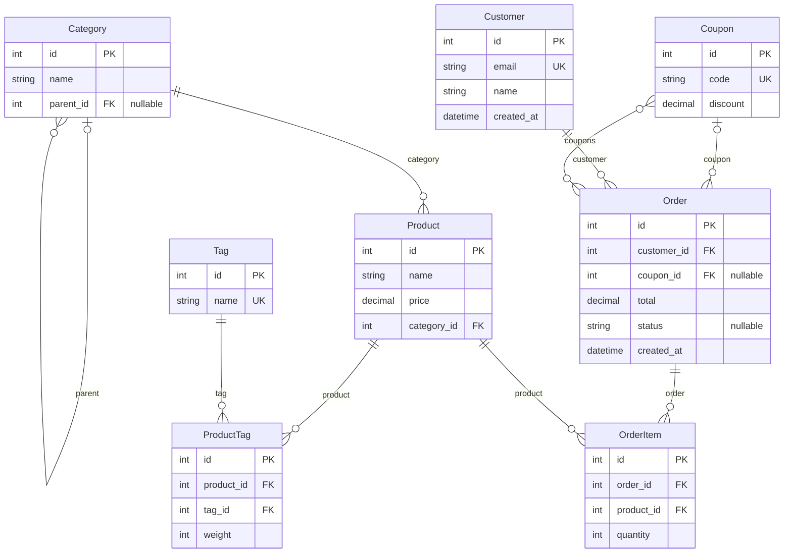

# django-mermaid-erd

[](https://github.com/Aaron-lab-c/django-mermaid-erd/actions/workflows/ci.yml)
[](https://pypi.org/project/django-mermaid-erd/)
[](https://pypi.org/project/django-mermaid-erd/)

**Graphviz-free ER diagrams for Django.** One command turns your models into
[Mermaid](https://mermaid.js.org/) text, which GitHub, GitLab, Notion and Obsidian
render natively. It's plain text, so it lives in git, shows up in diffs, and CI can
fail the build when the diagram is out of date. Images are optional.

```bash
python manage.py mermaid_erd -o docs/erd.md
```

This is the `shop` app from this package's own test project, generated by the tool:

<!-- mermaid-erd:start -->

<!-- mermaid-erd:end -->

## Why

| Existing option | Problem |
|---|---|
| `django-extensions graph_models` | Graphviz DOT output: needs Graphviz plus pygraphviz/pydot (painful on Windows), GitHub doesn't render it, generated images go stale |
| `django-schema-graph` | Interactive HTML: can't go in a README, can't be diffed |
| Drawing by hand | Always out of date |

django-mermaid-erd needs nothing but Django, never touches your database, and
always produces the same text for the same models, so `--check` and `git diff` mean something.

## Install

```bash
pip install django-mermaid-erd
```

There are two ways to run it.

**1. As a management command**: add the app to `INSTALLED_APPS`:

```python
INSTALLED_APPS = [
    # ...
    "django_mermaid_erd",
]
```

```bash
python manage.py mermaid_erd
```

**2. As a standalone CLI**: nothing to add to `INSTALLED_APPS`:

```bash
mermaid-erd --settings myproject.settings
# or: DJANGO_SETTINGS_MODULE=myproject.settings mermaid-erd
```

Both take exactly the same options. The CLI adds `--settings` and `--pythonpath`
(the current directory is always on the path).

## Recipes

```bash
# Print to stdout (all non-django.contrib apps)
python manage.py mermaid_erd

# Specific apps / models
python manage.py mermaid_erd shop blog.Post

# Markdown file (the ```mermaid fence is added automatically for .md)
python manage.py mermaid_erd -o docs/erd.md

# Keep a block in your README up to date
python manage.py mermaid_erd --inject README.md

# CI: fail (exit 1, with a diff) when the committed diagram is stale
python manage.py mermaid_erd -o docs/erd.md --check

# One model and everything within two hops of it
python manage.py mermaid_erd --focus shop.Order --depth 2

# UML class diagram with one namespace per app and inheritance arrows
python manage.py mermaid_erd --diagram class

# Big schema: keys only, one file per app
python manage.py mermaid_erd shop --fields keys -o docs/erd-shop.md
```

`--inject FILE` replaces everything between these two markers, and appends the
markers to the end of the file if they aren't there yet. Running it again gives the
same file, and CRLF files stay CRLF:

```markdown
<!-- mermaid-erd:start -->
<!-- mermaid-erd:end -->
```

### GitHub Actions

```yaml
- name: ER diagram is up to date
  run: python manage.py mermaid_erd -o docs/erd.md --check
```

### pre-commit

The hook needs your project's own Django environment, so it runs with `language: system`:

```yaml
repos:
  - repo: https://github.com/Aaron-lab-c/django-mermaid-erd
    rev: v0.1.0
    hooks:
      - id: mermaid-erd-check
        args: [--settings, myproject.settings, -o, docs/erd.md]
```

or, without depending on this repo:

```yaml
repos:
  - repo: local
    hooks:
      - id: mermaid-erd
        name: ER diagram is up to date
        entry: python manage.py mermaid_erd -o docs/erd.md --check
        language: system
        pass_filenames: false
        files: models
```

## What gets drawn

| Django | erDiagram |
|---|---|
| `ForeignKey` | `Target \|\|--o{ Source : "field"` (`\|o` when `null=True`) |
| `OneToOneField` | `Target \|\|--\|\| Source : "field"` |
| `ManyToManyField` | `Source }o--o{ Target : "field"`. With a custom `through` model in the diagram, the through model's two FKs are drawn instead. If it's excluded, the label says `via app.Through` |
| Multi-table inheritance | `Parent \|\|--\|\| Child : "inherits"`. The `*_ptr` column is hidden and parent fields aren't repeated |
| Proxy model | `Concrete \|\|..\|\| Proxy : "proxy"` (`--no-proxy` leaves proxies out) |
| `GenericForeignKey` | listed as a `generic` attribute; `--generic-edges` draws a dotted line to `ContentType` |
| Abstract base | not drawn; its fields appear on the children |
| `managed = False` | included (`--comments` marks it unmanaged) |
| FK to a model outside the diagram | attribute kept with a `"-> app.Model"` comment, no line |
| Same model name in two apps | only those get `app_Model` ids, shown as `app.Model` |

Attributes use the database column name (`customer_id`); `--field-names name` switches to `customer`.
Types: `int`, `float`, `decimal`, `bool`, `string`, `text`, `date`, `datetime`, `time`,
`duration`, `uuid`, `json`, `binary`, `file`, `image`, `ip`. A foreign key takes its target's
primary-key type. Unknown/third-party fields use their lower-cased class name without
`Field` (`ArrayField` → `array`). Model or app names that are Mermaid keywords
(`Class`, `Style`, `End`, …) are escaped automatically.

## Options

| Option | Default | Description |
|---|---|---|
| `TARGET ...` | all non-`django.contrib` apps | app labels or `app.Model` |
| `-e`, `--exclude PATTERN` | | app or `app.Model`, globs allowed (`shop.*Log`), repeatable |
| `--include-builtin` | off | include `django.contrib.*` (auth, contenttypes, …) |
| `--no-proxy` | | leave out proxy models |
| `--focus app.Model` | | only this model and its neighbours (`Model` alone works if unambiguous) |
| `--depth N` | 1 | neighbour distance for `--focus` |
| `-d`, `--diagram er\|class` | `er` | erDiagram or classDiagram |
| `--fields all\|keys\|none` | `all` | all attributes, only PK/FK/UK, or boxes only |
| `--types none\|short\|full` | `short` | `full` adds `string(100)`, `decimal(10,2)` (erDiagram only) |
| `--field-names attname\|name` | `attname` | `customer_id` or `customer` |
| `--sort-fields` | off | alphabetical attributes instead of definition order |
| `--max-fields N` | | truncate long models (adds `%% +N more fields`) |
| `--comments` | off | also annotate `choices`, unmanaged and proxy models (`nullable` is always shown) |
| `--verbose-names` | off | add explicitly set `verbose_name`s to attribute comments |
| `--generic-edges` | off | draw GenericForeignKey edges to `ContentType` |
| `--qualified` | off | `app_Model` ids for every model |
| `--direction TB\|BT\|LR\|RL` | | layout direction |
| `--no-banner` | | omit the `%% generated by django-mermaid-erd X.Y.Z` line |
| `--group-by-app` / `--no-group-by-app` | on | classDiagram: one `namespace` per app |
| `-o`, `--output FILE` | stdout | write to a file |
| `--md` | auto for `.md` | wrap in a ```` ```mermaid ```` fence |
| `--inject FILE` | | replace the marker block in FILE |
| `--check` | | compare with `-o` / `--inject` targets instead of writing: exit 1 with a unified diff if different |
| `--svg FILE`, `--png FILE` | | also render an image (see below) |
| `--renderer auto\|mmdc\|ink` | `auto` | image renderer |

Exit codes: `0` success, `1` out of date / error (one-line message, no traceback), `2` bad arguments.

> **Tip:** the banner contains the package version, so upgrading django-mermaid-erd
> makes `--check` fail once. Re-generate, or use `--no-banner` (or `"BANNER": False`).

## Settings

Project-wide defaults go in `settings.py`. Command-line options win. `EXCLUDE`
patterns are combined with any `--exclude`.

```python
MERMAID_ERD = {
    "EXCLUDE": ["*.Historical*"],   # e.g. django-simple-history models
    "INCLUDE_BUILTIN": False,
    "DIAGRAM": "er",               # or "class"
    "FIELDS": "all",               # "keys", "none"
    "TYPES": "short",              # "none", "full"
    "QUALIFIED": False,
    "BANNER": True,
}
```

Also accepted: `FIELD_NAMES`, `SORT_FIELDS`, `MAX_FIELDS`, `COMMENTS`, `VERBOSE_NAMES`,
`GENERIC_EDGES`, `DIRECTION`, `PROXY`, `GROUP_BY_APP`, `DEPTH`, `RENDERER`. Unknown keys are an error.

## Images (optional)

`--svg FILE` / `--png FILE` render an image with **no Python dependencies**:

* `--renderer mmdc` runs a local [`@mermaid-js/mermaid-cli`](https://github.com/mermaid-js/mermaid-cli)
  (`npm install -g @mermaid-js/mermaid-cli`). In containers/CI without a sandbox, set
  `MERMAID_ERD_PUPPETEER_CONFIG` to a JSON file containing `{"args": ["--no-sandbox"]}`.
* `--renderer ink` calls the public [mermaid.ink](https://mermaid.ink) service.
  **This sends your diagram (i.e. your model schema) to a third-party server.** Don't use it
  for private schemas.
* `--renderer auto` (default) uses `mmdc` if it is on `PATH`, otherwise `ink` (with a warning).

## Python API

```python
from django_mermaid_erd import generate, build_schema, render

text = generate("shop", diagram="class", fields="keys")    # same options as the command

from django.apps import apps
schema = build_schema(apps.get_app_config("shop").get_models())
text = render(schema, "er", types="full")
```

## Mermaid version notes

The output is validated against Mermaid 12 (`mmdc`) in CI. Entity aliases
(`shop_Tag["shop.Tag"]`), multiple keys (`PK, FK`) and `direction` in erDiagram need
a recent Mermaid (roughly 10.5+/11+). GitHub and GitLab always run a current version.
Older self-hosted renderers may not support all of them. If yours doesn't, use
`--fields keys` or avoid `--direction`.

## Large schemas

* `--fields keys` (only PK/FK/UK), or `--fields none` for boxes and lines only
* one file per app: `mermaid_erd shop -o docs/erd-shop.md`
* `--focus app.Model --depth N` for the neighbourhood of one model
* `--max-fields 8` to cap wide tables

## 中文說明

**django-mermaid-erd** 不需要 Graphviz，用一行指令把 Django model 關聯輸出成 Mermaid 文字。
GitHub、GitLab、Notion、Obsidian 都能直接渲染。輸出是純文字，可以進 git、可以 diff，
CI 可以用 `--check` 確認圖跟 model 保持同步。

```bash
pip install django-mermaid-erd
python manage.py mermaid_erd -o docs/erd.md           # 需把 "django_mermaid_erd" 加進 INSTALLED_APPS
mermaid-erd --settings myproject.settings              # 或不加 INSTALLED_APPS，直接用 CLI
python manage.py mermaid_erd -o docs/erd.md --check   # CI：過期就 exit 1 並印出 diff
python manage.py mermaid_erd --inject README.md        # 更新 README 中的標記區塊
python manage.py mermaid_erd --focus shop.Order --depth 2
```

* 只依賴 Django，完全不查詢資料庫。
* 同一份 model 在任何機器、任何 Python 版本，輸出都逐字相同。
* 圖片輸出（`--svg` / `--png`）是選配功能。`--renderer ink` 會把 schema 送到第三方服務 mermaid.ink，私有專案請改用本機的 `mmdc`。

## License

MIT © ARON

django-mermaid-erd is a third-party package and is not affiliated with or endorsed by
the Django Software Foundation. "Django" is a registered trademark of the Django Software Foundation.
